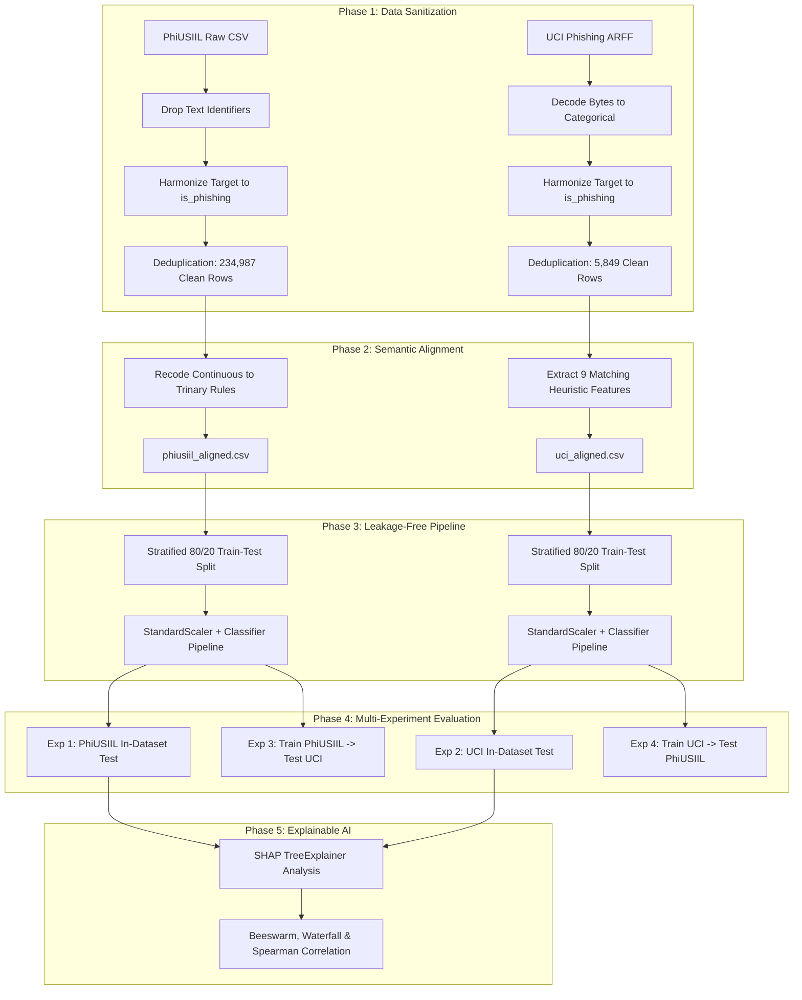
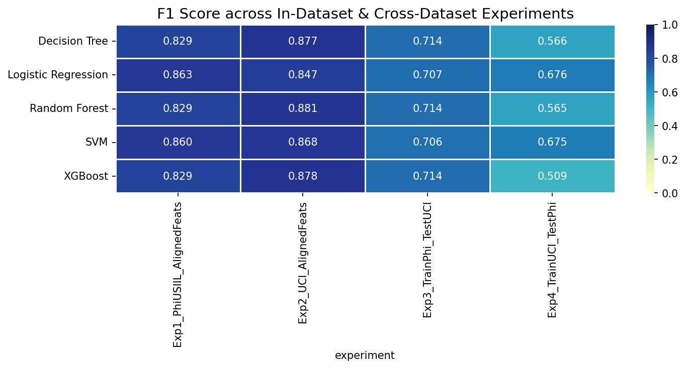
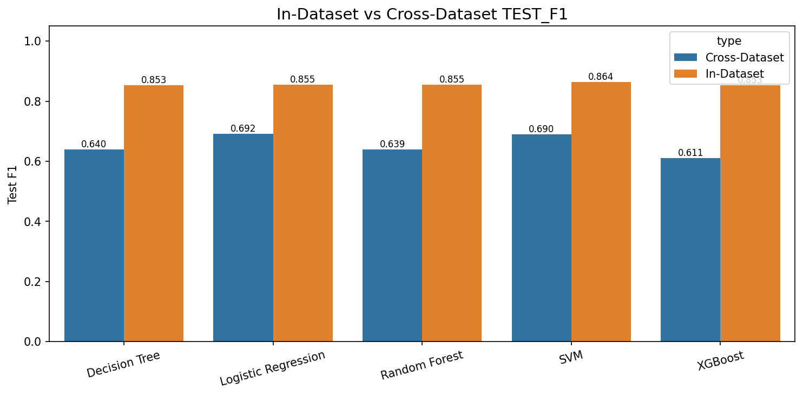
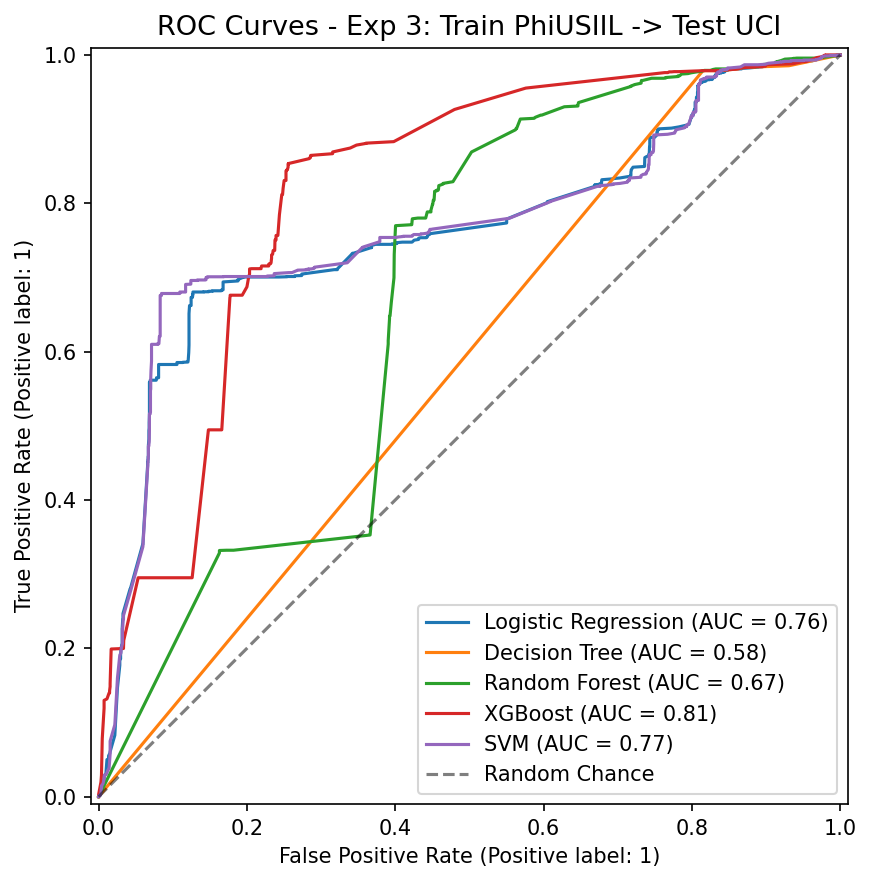
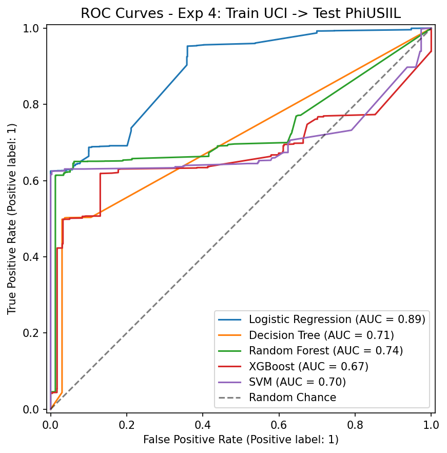
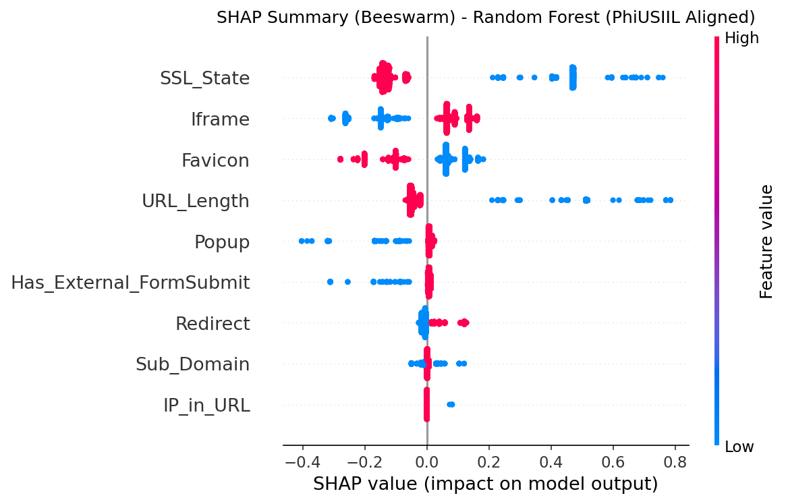
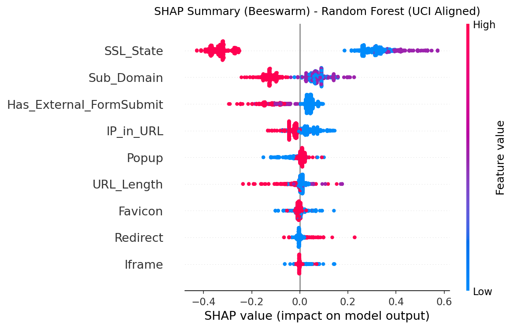
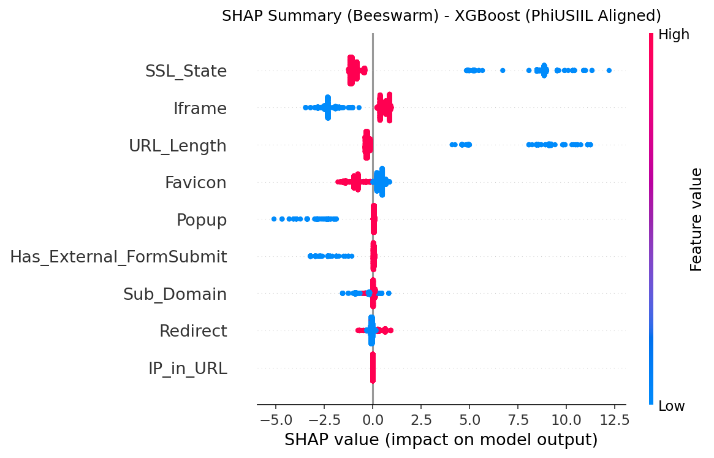
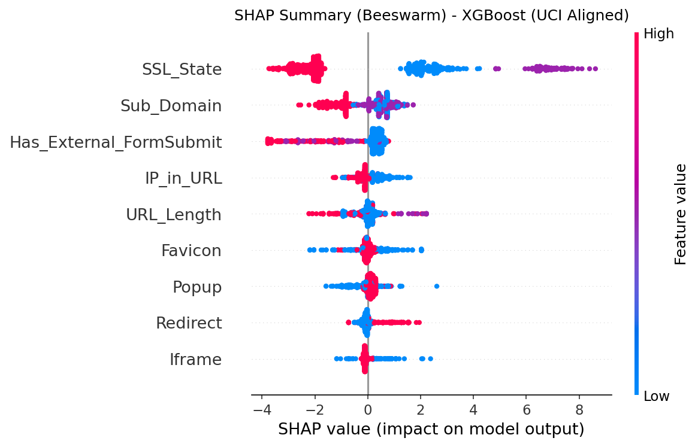

<div align="center">

# Cross-Dataset Phishing Website Detection Using Ensemble Learning and Explainable Artificial Intelligence

An empirical research study investigating whether machine learning classifiers learn invariant signatures of phishing or memorize dataset-specific artifacts across heterogeneous web corpora.

[](https://www.python.org/)
[](https://scikit-learn.org/)
[](https://xgboost.readthedocs.io/)
[](https://shap.readthedocs.io/)
[](https://colab.research.google.com/)
[](#license)
[](#validation-and-reproducibility)

</div>

---

## Table of Contents
- [Overview](#overview)
- [Research Objectives and Research Questions](#research-objectives-and-research-questions)
- [Datasets](#datasets)
- [Methodology](#methodology)
- [Feature Alignment](#feature-alignment)
- [Models and Techniques](#models-and-techniques)
- [Experimental Results](#experimental-results)
- [Explainability (SHAP)](#explainability-shap)
- [Validation and Reproducibility](#validation-and-reproducibility)
- [Project Structure](#project-structure)
- [Installation and Usage](#installation-and-usage)
- [Limitations](#limitations)
- [Future Work](#future-work)
- [References](#references)
- [Author and Acknowledgments](#author-and-acknowledgments)
- [License](#license)

---

## Overview

Automated phishing detection systems frequently report classification accuracies exceeding 99% in published literature. However, conventional benchmarks rely on random train-test splits sampled from the same underlying dataset collection. This experimental design creates an artificial evaluation environment: models exploit dataset-specific artifacts, temporal clustering, and synthetic extraction shortcuts rather than learning invariant indicators of malicious intent.

This project introduces a rigorous **cross-dataset evaluation framework** across two distinct public benchmarks: the large-scale **PhiUSIIL Phishing URL Dataset** (2023) and the classical **UCI Phishing Websites Dataset** (2014). Following data sanitization, deduplication, and a 9-feature semantic alignment, five supervised algorithms (Logistic Regression, Decision Trees, Random Forests, XGBoost, and SVM) were evaluated across both intra-dataset and inter-dataset regimes. Explainable Artificial Intelligence (XAI) using SHAP (SHapley Additive exPlanations) is applied to explain the mathematical divergence between models.

### Key Highlights
- **Cross-Dataset Stress Testing:** Moving beyond standard intra-dataset benchmarking to measure generalization degradation across distinct web distributions.
- **Strict Leakage-Free Design:** Stratified splitting executed before any transformation, with scaling and calibration encapsulated entirely inside `sklearn.pipeline.Pipeline`.
- **Systematic Semantic Harmonization:** Mapping heterogeneous URL and DOM features into a unified trinary `{-1, 0, 1}` domain backed by published heuristic definitions.
- **Five Diverse Model Families:** Comparing linear classifiers, single trees, bagging ensembles, boosting ensembles, and kernel/linear margin classifiers.
- **Game-Theoretic XAI:** Applying `shap.TreeExplainer` and Spearman rank correlation to diagnose feature attribution shifts between corpora.
- **Reproducible Engineering:** Clean modular architecture in `src/`, automated verification suites, fixed random states (`42`), and standalone Colab-compatible notebooks.

---

## Research Objectives and Research Questions

This study addresses five specific research questions:

1. **Does Random Forest generalize across datasets?**  
   *Question:* Can a high-capacity bagging ensemble trained on modern URL and webpage features accurately identify phishing attacks in an independently collected dataset without retraining?
2. **Does XGBoost lose accuracy cross-dataset?**  
   *Question:* To what degree does gradient boosting overfit to non-linear feature splits of a single corpus, and does its predictive performance degrade under distribution shift?
3. **Which features are consistent across datasets?**  
   *Question:* Which lexical, structural, or behavioral indicators retain their discriminative power across diverse web corpora collected almost a decade apart?
4. **Does feature selection / alignment help?**  
   *Question:* How does restricting models to semantically equivalent, aligned features impact intra-dataset baseline accuracy and cross-dataset transferability?
5. **Can explainable AI reveal common phishing characteristics?**  
   *Question:* Do SHAP attribution values show consistent feature prioritization between models trained on different datasets, or do models rely on disjoint decision mechanisms?

---

## Datasets

The project uses two public phishing benchmarks obtained from the UCI Machine Learning Repository:

| Characteristic | PhiUSIIL Phishing URL Dataset | UCI Phishing Websites Dataset |
| :--- | :--- | :--- |
| **Repository ID** | [UCI ID 967](https://archive.ics.uci.edu/dataset/967) | [UCI ID 327](https://archive.ics.uci.edu/dataset/327) |
| **Publication Year** | 2023 (Prasad & Chandra) | 2014 (Mohammad et al.) |
| **Raw Sample Count** | 235,795 rows | 11,055 rows |
| **Cleaned Unique Records** | 234,987 rows (808 duplicates removed) | 5,849 rows (5,206 duplicates removed) |
| **Raw Dimensions** | 54 features + label | 30 features + label |
| **Original Label Coding** | `0` = Phishing, `1` = Legitimate | `-1` = Phishing, `1` = Legitimate |
| **Unified Target** | **`is_phishing` (1 = Phishing, 0 = Legitimate)** | **`is_phishing` (1 = Phishing, 0 = Legitimate)** |
| **Cleaned Class Balance** | 42.6% Phishing ($n=100,136$), 57.4% Legit | 51.6% Phishing ($n=3,019$), 48.4% Legit |
| **Raw Format** | CSV | ARFF (Weka) |
| **Noise & Ambiguity** | 0 conflicting feature vectors | **64 conflicting feature vectors** (identical features, opposing labels) |

*Text Identifier Dropping:* In PhiUSIIL, non-numeric and text identifier columns (`FILENAME`, `URL`, `Domain`, `TLD`, `Title`) were discarded prior to modeling to prevent algorithms from memorizing specific string tokens.

---

## Methodology

The research pipeline is organized into five functional phases:



### Four-Experiment Design

| Experiment | Training Dataset | Test Dataset | Feature Set | Primary Purpose |
| :---: | :---: | :---: | :---: | :--- |
| **Exp 1** | PhiUSIIL (Train Split) | PhiUSIIL (Test Split) | All Features (50) vs. Aligned (9) | In-dataset baseline & impact of alignment |
| **Exp 2** | UCI Phishing (Train Split) | UCI Phishing (Test Split) | All Features (30) vs. Aligned (9) | In-dataset baseline & impact of alignment |
| **Exp 3** | PhiUSIIL (Train Split) | UCI Phishing (Full Dataset) | Aligned Features (9) | Cross-dataset generalization (Modern $\to$ Legacy) |
| **Exp 4** | UCI Phishing (Train Split) | PhiUSIIL (Full Dataset) | Aligned Features (9) | Cross-dataset generalization (Legacy $\to$ Modern) |

---

## Feature Alignment

Cross-dataset evaluation requires that features share identical mathematical representations and semantics. Using published heuristic rules from Mohammad et al. (2014) and dataset documentation from Prasad & Chandra (2023), nine common concepts were aligned into UCI's trinary domain `{-1: Phishing, 0: Suspicious, 1: Legitimate}`:

| Concept | PhiUSIIL Column | UCI Column | Transformation Logic | Confidence | Heuristic Source |
| :--- | :--- | :--- | :--- | :---: | :--- |
| **`IP_in_URL`** | `IsDomainIP` | `having_IP_Address` | $1 \to -1$ (phishing), $0 \to 1$ (legit) | High | Rule 1 (Mohammad et al.) |
| **`URL_Length`** | `URLLength` | `URL_Length` | $\ge 75 \to -1$, $54\text{--}74 \to 0$, $<54 \to 1$ | High | Rule 2 (Mohammad et al.) |
| **`Sub_Domain`** | `NoOfSubDomain` | `having_Sub_Domain` | $\le 1 \to 1$ (legit), $2 \to 0$, $\ge 3 \to -1$ | High | Rule 7 (Mohammad et al.) |
| **`SSL_State`** | `IsHTTPS` | `SSLfinal_State` | $1 \to 1$ (HTTPS present), $0 \to -1$ | Medium | Rule 8 (Mohammad et al.) |
| **`Favicon`** | `HasFavicon` | `Favicon` | $1 \to 1$ (same domain), $0 \to -1$ | High | Rule 10 (Mohammad et al.) |
| **`Iframe`** | `NoOfiFrame` | `Iframe` | $>0 \to -1$ (present), $0 \to 1$ | High | Rule 23 (Mohammad et al.) |
| **`Popup`** | `NoOfPopup` | `popUpWidnow` | $>0 \to -1$ (present), $0 \to 1$ | High | Rule 22 (Mohammad et al.) |
| **`Redirect`** | `NoOfURLRedirect` | `Redirect` | $\ge 1 \to 1$, $0 \to 0$ | Low | Rule 19 (Adapted; max in Phi is 1) |
| **`Has_External_FormSubmit`** | `HasExternalFormSubmit` | `SFH` | $1 \to -1$ (external), $0 \to 1$ | Medium | Rule 16 (Mohammad et al.) |

### Limitations of Alignment Equivalence
- **`Redirect`:** UCI Rule 19 defines phishing when redirect count $\ge 4$. In PhiUSIIL, `NoOfURLRedirect` has an empirical maximum of 1, necessitating a relaxed threshold ($\ge 1$).
- **`SSL_State`:** UCI incorporates certificate age and issuer trustworthiness; PhiUSIIL only captures protocol presence (`IsHTTPS`).
- **`Has_External_FormSubmit`:** UCI contains a third state for `about:blank`; PhiUSIIL captures external posting as a strict binary flag.

---

## Models and Techniques

### Supervised Algorithms

| Model | Scaler Step | Hyperparameter Configuration | Rationale / Computational Role |
| :--- | :---: | :--- | :--- |
| **Logistic Regression** | `StandardScaler` | $C=1.0$, $L_2$ penalty, `class_weight='balanced'` | Convex linear baseline with calibrated probabilities |
| **Decision Tree** | Passthrough | CART criterion, `random_state=42` | Interpretable non-parametric axis-aligned splitter |
| **Random Forest** | Passthrough | 200 estimators, bootstrap sampling | Bagging ensemble reducing variance across de-correlated trees |
| **XGBoost** | Passthrough | 200 estimators, `eval_metric='logloss'`, lr=0.1 | Gradient boosting optimizing sequential pseudo-residuals |
| **SVM (Linear / RBF)** | `StandardScaler` | PhiUSIIL: `LinearSVC` + `CalibratedClassifierCV`<br>UCI: `SVC(kernel='rbf', probability=True)` | Margin maximization; linear formulation prevents $\mathcal{O}(n^2)$ scaling on 235k rows |

### Feature Selection and Tuning
- **Mutual Information (MI):** Computed across all 50 continuous/discrete features in PhiUSIIL. Top features identified: `URLSimilarityIndex` (0.661), `LineOfCode` (0.596), and `NoOfExternalRef` (0.563).
- **Ablation Study:** Removing the top three features (`URLSimilarityIndex`, `URLCharProb`, `TLDLegitimateProb`) from Random Forest reduced test accuracy marginally from **99.998% to 99.955%**, proving that PhiUSIIL possesses multiple redundant deterministic features.
- **Hyperparameter Optimization:** `RandomizedSearchCV` on UCI aligned features identified optimal shallow trees (`max_depth=3`, $F_1 = 0.883$) that mitigate cross-validation overfitting.

---

## Experimental Results

All metrics below are drawn directly from executed experiments recorded in `results/tables/05_all_4_experiments_results.csv` and `results/tables/03_baseline_results.csv`.

### Full Cross-Dataset and In-Dataset Performance Table

| Experiment | Model | Accuracy | Precision | Recall | $F_1$-Score | ROC-AUC | True Phish Rate | Pred Phish Rate |
| :--- | :--- | :---: | :---: | :---: | :---: | :---: | :---: | :---: |
| **Exp 1: PhiUSIIL Aligned** | Logistic Regression | 0.8727 | 0.7953 | **0.9445** | **0.8635** | 0.9582 | 0.4261 | 0.5060 |
| | Decision Tree | 0.8727 | **0.9731** | 0.7213 | 0.8285 | 0.9590 | 0.4261 | 0.3158 |
| | Random Forest | 0.8727 | **0.9731** | 0.7213 | 0.8285 | 0.9590 | 0.4261 | 0.3158 |
| | XGBoost | 0.8727 | **0.9731** | 0.7213 | 0.8285 | **0.9590** | 0.4261 | 0.3158 |
| | SVM (LinearSVC) | **0.8728** | 0.8111 | 0.9146 | 0.8598 | 0.9577 | 0.4261 | 0.4805 |
| **Exp 2: UCI Aligned** | Logistic Regression | 0.8521 | **0.9074** | 0.7947 | 0.8473 | 0.9029 | 0.5162 | 0.4521 |
| | Decision Tree | 0.8752 | 0.8935 | 0.8609 | 0.8769 | 0.9275 | 0.5162 | 0.4974 |
| | Random Forest | **0.8786** | 0.8929 | **0.8692** | **0.8809** | 0.9325 | 0.5162 | 0.5026 |
| | XGBoost | 0.8761 | 0.8923 | 0.8642 | 0.8780 | **0.9340** | 0.5162 | 0.5000 |
| | SVM (RBF Kernel) | 0.8692 | 0.9093 | 0.8295 | 0.8675 | 0.9070 | 0.5162 | 0.4709 |
| **Exp 3: Phi $\to$ UCI** | Logistic Regression | 0.5837 | 0.5551 | 0.9748 | 0.7074 | 0.7616 | 0.5162 | 0.9065 |
| | Decision Tree | **0.5945** | **0.5615** | **0.9788** | **0.7136** | 0.5814 | 0.5162 | 0.8998 |
| | Random Forest | **0.5945** | **0.5615** | **0.9788** | **0.7136** | 0.6722 | 0.5162 | 0.8998 |
| | XGBoost | **0.5945** | **0.5615** | **0.9788** | **0.7136** | **0.8149** | 0.5162 | 0.8998 |
| | SVM | 0.5825 | 0.5545 | 0.9722 | 0.7062 | 0.7677 | 0.5162 | 0.9049 |
| **Exp 4: UCI $\to$ Phi** | Logistic Regression | **0.7916** | **1.0000** | **0.5111** | **0.6764** | **0.8517** | 0.4261 | 0.2178 |
| | Decision Tree | 0.7312 | 0.9081 | 0.4109 | 0.5658 | 0.6672 | 0.4261 | 0.1928 |
| | Random Forest | 0.7376 | 0.9621 | 0.3999 | 0.5650 | 0.6681 | 0.4261 | 0.1771 |
| | XGBoost | 0.7122 | 0.9340 | 0.3494 | 0.5085 | 0.5869 | 0.4261 | 0.1594 |
| | SVM | 0.7898 | 0.9915 | 0.5111 | 0.6745 | 0.6139 | 0.4261 | 0.2197 |

### Visual Comparisons

<div align="center">

| Metric Transition Heatmap ($F_1$-Score) | In-Dataset vs. Cross-Dataset Comparison |
| :---: | :---: |
|  |  |
| *Figure 1: Macro $F_1$ across all four experimental conditions.* | *Figure 2: Mean degradation between intra- and cross-dataset testing.* |

</div>

<div align="center">

| ROC Curves: Experiment 3 (Phi $\to$ UCI) | ROC Curves: Experiment 4 (UCI $\to$ Phi) |
| :---: | :---: |
|  |  |
| *Figure 3: Overlaid ROC curves testing on UCI.* | *Figure 4: Overlaid ROC curves testing on PhiUSIIL.* |

</div>

### Key Findings (Answering the Research Questions)

1. **Does Random Forest generalize?**  
   **No.** Random Forest achieves an in-dataset $F_1$ of 0.8809 on UCI and 0.8285 on PhiUSIIL, but drops to **$F_1 = 0.7136$ (Exp 3)** and **$F_1 = 0.5650$ (Exp 4)**. In Exp 4, its recall collapses to **39.99%**, missing 60% of real phishing instances.
2. **Does XGBoost lose accuracy cross-dataset?**  
   **Yes, substantially.** XGBoost drops from 87.61% in-dataset accuracy to **59.45% in Exp 3** and **71.22% in Exp 4**. In Exp 4, its recall reaches the lowest of all models (**34.94%**), proving that gradient-boosted decision boundaries overfit to corpus-specific thresholds.
3. **Which features are consistent across datasets?**  
   **`SSL_State` is the sole invariant anchor.** It ranks as the #1 predictor across both datasets in SHAP analyses. Conversely, `Iframe` and `Favicon` are highly informative in PhiUSIIL but negligible in UCI.
4. **Does feature alignment help?**  
   **Yes, by eliminating artificial shortcuts.** Restricting PhiUSIIL from 50 features down to 9 aligned features reduces in-dataset $F_1$ from 1.0000 to a realistic 0.8285–0.8635, exposing true operational behavior.
5. **Can explainable AI reveal common phishing characteristics?**  
   **Yes, but it reveals divergence.** While models agree that missing SSL flags phishing, they disagree on secondary feature rankings (Spearman correlation $\rho \le 0.00$), explaining mathematically why cross-dataset transfer fails.

---

## Explainability (SHAP)

Using `shap.TreeExplainer`, game-theoretic Shapley values were computed for Random Forest and XGBoost models trained on both aligned datasets.

<div align="center">

| SHAP Summary: Random Forest (PhiUSIIL) | SHAP Summary: Random Forest (UCI) |
| :---: | :---: |
|  |  |
| *Figure 5: Feature attribution for RF on PhiUSIIL.* | *Figure 6: Feature attribution for RF on UCI.* |

</div>

<div align="center">

| SHAP Summary: XGBoost (PhiUSIIL) | SHAP Summary: XGBoost (UCI) |
| :---: | :---: |
|  |  |
| *Figure 7: Feature attribution for XGBoost on PhiUSIIL.* | *Figure 8: Feature attribution for XGBoost on UCI.* |

</div>

### Mean Absolute SHAP Values (`results/tables/06_shap_importance.csv`)

| Feature | RF PhiUSIIL | XGB PhiUSIIL | RF UCI | XGB UCI | Cross-Dataset Consensus |
| :--- | :---: | :---: | :---: | :---: | :---: |
| **`SSL_State`** | **0.2033** | **2.6433** | **0.3317** | **2.7815** | **Universal Primary Anchor** |
| **`URL_Length`** | 0.0769 | 0.8864 | 0.0169 | 0.2623 | Secondary in PhiUSIIL |
| **`Sub_Domain`** | 0.0058 | 0.1328 | **0.0910** | **0.8051** | Strong in UCI, Weak in Phi |
| **`Favicon`** | 0.1058 | 0.5862 | 0.0099 | 0.2218 | PhiUSIIL-specific signal |
| **`Iframe`** | **0.1206** | **1.1732** | 0.0069 | 0.1577 | PhiUSIIL-specific signal |
| **`Popup`** | 0.0194 | 0.2267 | 0.0173 | 0.2208 | Weak across both |
| **`Redirect`** | 0.0138 | 0.1065 | 0.0095 | 0.1611 | Weak across both |
| **`Has_External_FormSubmit`** | 0.0140 | 0.1703 | **0.0595** | **0.7864** | Strong in UCI only |
| **`IP_in_URL`** | 0.0004 | 0.0000 | 0.0334 | 0.3148 | UCI-specific signal |

### Spearman Rank Correlation (`results/tables/06_shap_spearman.csv`)
- **Random Forest (PhiUSIIL vs. UCI Rankings):** $\rho = -0.1667$ ($p = 0.6682$)
- **XGBoost (PhiUSIIL vs. UCI Rankings):** $\rho = 0.0000$ ($p = 1.0000$)

*Diagnostic Conclusion:* Aside from `SSL_State`, there is zero monotonic correlation in how feature importance ranks across the two datasets. This divergence explains the generalization gap: models optimize for dataset-specific secondary patterns that fail under domain transfer.

---

## Validation and Reproducibility

To ensure strict scientific reproducibility:
1. **Deduplication Before Splitting:** Exact duplicate instances were purged prior to train-test partition creation, preventing data leakage across splits.
2. **Pipeline Encapsulation:** Scalers and estimators are strictly bounded within `sklearn.pipeline.Pipeline` objects; test and cross-dataset sets are evaluated only via `pipeline.predict()`.
3. **Deterministic Random State:** All splits, k-fold cross-validations, tree seeds, and hyperparameter searches use fixed `random_state = 42`.
4. **Shuffled-Label Sanity Check:** In `tests/test_pipeline.py`, training models on randomly permuted labels drops ROC-AUC to random chance ($0.40 \le \text{AUC} \le 0.65$), confirming that pipelines do not leak structural information.
5. **Master Automated Script:** An end-to-end execution script (`run_all.py`) and test runner (`scripts/verify_project.py`) verify dataset, model, and visualization outputs.

---

## Project Structure

```text
phishing-project/
├── data/
│   ├── raw/                              # Original benchmark files (UCI 967 & UCI 327)
│   └── processed/                        # Deduplicated, cleaned, and aligned datasets
│       ├── phiusiil_clean.csv            # Cleaned PhiUSIIL numeric dataset (234,987 rows)
│       ├── uci_phishing_clean.csv        # Cleaned UCI Phishing dataset (5,849 rows)
│       ├── phiusiil_aligned.csv          # 9 aligned features for PhiUSIIL + is_phishing
│       ├── uci_aligned.csv               # 9 aligned features for UCI + is_phishing
│       └── preprocessing_meta.json       # Deduplication and schema audit records
├── notebooks/                            # Step-by-step Jupyter notebooks (Colab-ready)
│   ├── 01_eda_preprocessing.ipynb        # Ingestion, label harmonization, deduplication
│   ├── 02_feature_alignment.ipynb        # Semantic mapping & trinary recoding
│   ├── 03_baseline_models.ipynb          # Intra-dataset baseline experiments (Exp 1 & 2)
│   ├── 04_tuning_feature_selection.ipynb # Mutual Information, ablation & hyperopt
│   ├── 05_cross_dataset_experiments.ipynb# Cross-dataset evaluation (Exp 3 & 4)
│   └── 06_shap_explainability.ipynb      # TreeExplainer, beeswarm, waterfall & Spearman
├── src/                                  # Modular Python package
│   ├── __init__.py                       # Package initialiser
│   ├── data_utils.py                     # Loaders, harmonizers, skewness checks
│   ├── alignment.py                      # 9-feature alignment rules and recoders
│   ├── models.py                         # Sklearn Pipeline definitions and search grids
│   ├── evaluation.py                     # Stratified CV, test metrics, calibration
│   └── plotting.py                       # Overlaid ROC, confusion matrices, heatmaps
├── results/
│   ├── figures/                          # 34 publication-grade figures (150 DPI PNG)
│   ├── tables/                           # CSV reports for baselines, cross-dataset & SHAP
│   └── models/                           # 22 serialized .joblib pipeline files
├── report/
│   ├── project_report.md                 # Full academic project report
│   └── viva_notes.md                     # 20 oral defense Q&A preparation notes
├── scripts/
│   ├── run_shap_and_viz.py               # Standalone execution of SHAP and figures
│   ├── verify_project.py                 # Automated integrity and sanity check audit
│   └── build_notebooks.py                # Notebook builder and validator
├── run_all.py                            # Master entry-point for end-to-end execution
├── requirements.txt                      # Pinned Python package dependencies
└── README.md                             # Repository documentation
```

---

## Installation and Usage

### Prerequisites
- Python 3.10, 3.11, or 3.12
- 8 GB RAM minimum (16 GB recommended for full PhiUSIIL processing)

### Local Environment Setup

```bash
# 1. Clone repository
git clone https://github.com/Ankitkesarwani1/phishing-project.git
cd phishing-project

# 2. Create and activate a virtual environment
python -m venv venv
# On Windows:
venv\Scripts\activate
# On Linux/macOS:
source venv/bin/activate

# 3. Install pinned dependencies
pip install -r requirements.txt
```

### Reproducing All Results

To run the full automated verification and visualization pipeline end-to-end:

```bash
# Run master pipeline
python run_all.py

# Or run the integrity verification audit
python scripts/verify_project.py
```

### Running the Notebooks in Sequence

Start Jupyter Lab or Notebook:
```bash
jupyter lab notebooks/
```
Execute notebooks in numerical order:
1. `01_eda_preprocessing.ipynb`: Data loading, deduplication, and EDA.
2. `02_feature_alignment.ipynb`: Recoding continuous features into the trinary scheme.
3. `03_baseline_models.ipynb`: Training and evaluating in-dataset baselines.
4. `04_tuning_feature_selection.ipynb`: Feature ranking, ablation, and tuning.
5. `05_cross_dataset_experiments.ipynb`: Cross-dataset transfer evaluations.
6. `06_shap_explainability.ipynb`: SHAP global, local, and rank correlation analysis.

### Run on Google Colab
All notebooks detect Google Colab automatically. To run on Colab:
1. Upload the `phishing-project` directory to your Google Drive at `/MyDrive/phishing-project/`.
2. Open any notebook from Google Drive in Colab.
3. The first cell mounts Google Drive and sets `sys.path` automatically:
```python
from google.colab import drive
drive.mount('/content/drive')
```

---

## Limitations

1. **Temporal Gap:** UCI was compiled in 2014, while PhiUSIIL was collected in 2023. Natural evolution in web technologies (e.g., ubiquitous HTTPS adoption via Let's Encrypt) alters feature priors.
2. **Dimensionality Reduction:** Restricting models to 9 alignable features drops 45 features from PhiUSIIL and 21 features from UCI, lowering potential intra-dataset capacity.
3. **Approximate Semantic Mapping:** Features such as `Redirect` (threshold lowered to $\ge 1$) and `SSL_State` (missing cert validity duration in PhiUSIIL) are approximations.
4. **No Live-Traffic Validation:** Evaluation is conducted on static public benchmarks without active domain resolution against contemporary zero-hour campaigns.

---

## Future Work

1. **Active Domain Adaptation:** Implement unsupervised domain adaptation (e.g., Correlation Alignment or Adversarial Discriminative Domain Adaptation) to align feature distributions without target labels.
2. **Dynamic Decision Threshold Calibration:** Replace fixed $0.5$ classification thresholds with cost-sensitive threshold moving tuned to live false-positive constraints.
3. **Raw Lexical Deep Learning:** Train character-level Convolutional Neural Networks (Char-CNN) or Transformer tokenizers directly on raw URL strings to bypass manual heuristic feature extraction.
4. **Certificate Transparency Integration:** Augment URL lexical features with real-time Certificate Transparency (CT) log telemetry.

---

## References

1. **Prasad, A., & Chandra, S. (2023).** PhiUSIIL: A novel dataset for phishing URL detection using structural, lexical and behavioral features. *Computers & Security*, 124, 102983.
2. **Mohammad, R. M., Thabtah, F., & McCluskey, L. (2014).** Predicting phishing websites based on self-structuring neural network. *Neural Computing and Applications*, 25(2), 443–458.
3. **Lundberg, S. M., & Lee, S. I. (2017).** A unified approach to interpreting model predictions. *Advances in Neural Information Processing Systems (NeurIPS)*, 30, 4765–4774.
4. **Apruzzese, G., Laskov, P., & Schneider, J. (2023).** The role of machine learning in cybersecurity: A survey of challenges and directions. *IEEE Transactions on Information Forensics and Security*.

---

## Author and Acknowledgments

- **Author:** Ankit Kesarwani
- **Institution:** Vivekanand Education Society Institute of Technology
- **GitHub:** [@Ankitkesarwani1](https://github.com/Ankitkesarwani1)
- **Contact:** `kesarwaniankit2005@gmail.com`

**Acknowledgments:**
- [UCI Machine Learning Repository](https://archive.ics.uci.edu/) for hosting and maintaining the benchmark corpora.
- The open-source scientific computing ecosystem: `scikit-learn`, `xgboost`, `shap`, `pandas`, `numpy`, and `matplotlib`.

---

## License

This project is licensed under the [MIT License](LICENSE).
