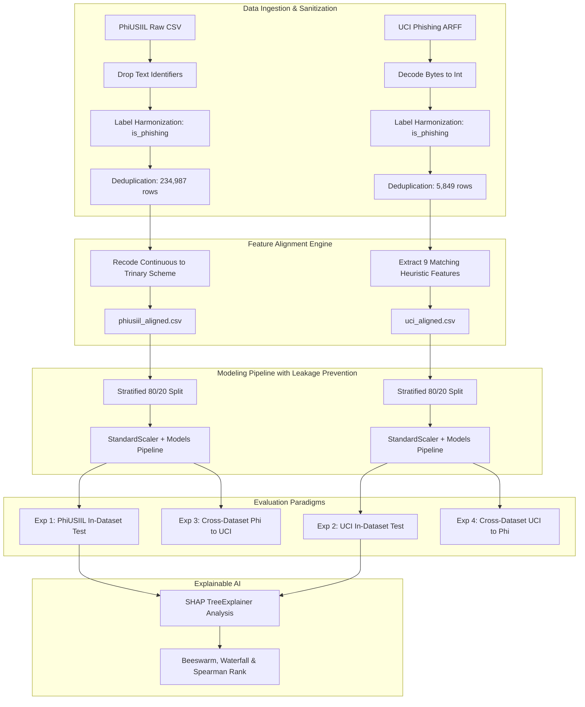

# Cross-Dataset Phishing Website Detection Using Ensemble Learning and Explainable Artificial Intelligence

**Academic Mini-Project Report**  
*Department of Artificial Intelligence & Data Science*  
*Third-Year B.Tech Curriculum*  

---

## Abstract
Machine learning-based phishing detection systems typically report in-dataset classification accuracies exceeding 99%. However, such evaluations obscure whether models learn invariant indicators of malicious intent or simply exploit dataset-specific sampling biases and deterministic artifacts. This study systematically investigates the cross-dataset generalizability of five supervised learning paradigms—Logistic Regression, Decision Trees, Random Forests, XGBoost, and Support Vector Machines—across two benchmark corpora: the PhiUSIIL Phishing URL Dataset (234,987 instances) and the UCI Phishing Websites Dataset (5,849 unique instances). Following deduplication and label harmonization, we establish a semantic mapping aligning 9 core syntactic and behavioral features into a unified trinary scheme. While models achieve robust in-dataset performance ($F_1 = 0.83 - 0.88$ on aligned subsets), cross-dataset evaluation demonstrates severe performance degradation ($F_1$ drops to $0.51 - 0.71$). Non-linear ensembles suffer severe over-prediction or under-prediction due to covariate shift, whereas regularized Logistic Regression demonstrates the highest cross-domain stability ($F_1 = 0.707$ and $F_1 = 0.676$). SHAP (SHapley Additive exPlanations) analysis reveals that while `SSL_State` acts as a universal predictor across domains, the relative importance of secondary features diverges completely (Spearman $\rho = -0.167$ for Random Forest, $\rho = 0.000$ for XGBoost). These findings demonstrate that high in-dataset accuracy is an unreliable proxy for operational defense and underscore the necessity of cross-distribution validation in cyber threat intelligence.

---

## 1. Introduction & Motivation
Phishing attacks represent one of the most persistent attack vectors in modern cybersecurity, serving as the initial entry point for identity theft, credential harvesting, financial fraud, and ransomware deployment. In response, security researchers have developed a broad spectrum of automated detection mechanisms driven by classical machine learning and deep learning algorithms.

Despite widespread reports of near-perfect classification performance in peer-reviewed literature (often claiming 98% to 100% accuracy), real-world automated phishing filters continue to experience unacceptable false-positive and false-negative rates when confronted with live web traffic. This disparity stems from an experimental design limitation: **intra-dataset testing**. When a model is trained, validated, and tested on random splits drawn from the same underlying distribution, it naturally capitalizes on:
1. Temporal correlation (attacks collected during the same campaign window share identical hosting infrastructure).
2. Extraction heuristics (specific web-crawling tools parsing HTML elements in idiosyncratic ways).
3. Synthetic or deterministic features engineered within a single lab environment.

To overcome these pitfalls, this project introduces a **cross-dataset evaluation methodology**. By training classifiers on one independently collected dataset and testing them on a completely distinct dataset compiled nearly a decade apart with differing collection methodologies, we quantify the true generalization capability of modern machine learning models and apply Explainable AI (XAI) to uncover the underlying distribution shifts.

---

## 2. Research Objectives & Core Questions
This research investigates five foundational questions:
1. **RQ1 (Generalization vs. Memorization):** Do machine learning models trained on one phishing repository generalize effectively to an unseen external repository, or do they suffer catastrophic performance degradation?
2. **RQ2 (Model Robustness):** Which algorithmic family—linear models, single decision trees, bagging ensembles, boosting ensembles, or margin-based classifiers—exhibits the greatest resilience to cross-dataset transfer?
3. **RQ3 (Feature Invariance):** Which syntactic, lexical, or structural features transfer reliably across diverse datasets, and which ones act as misleading dataset-specific artifacts?
4. **RQ4 (Ensemble Utility):** Do complex ensemble architectures (Random Forest, XGBoost) maintain their superiority over simpler linear baselines when evaluated out-of-distribution?
5. **RQ5 (Explainability Convergence):** Do SHAP feature attributions agree across datasets, or do models rely on disjoint decision mechanisms to achieve comparable in-dataset performance?

---

## 3. Related Literature
Automated phishing detection generally partitions into two analytical regimes: URL lexical analysis and webpage content analysis.

- **UCI Phishing Websites Dataset (Mohammad, McCluskey, & Thabtah, 2014):**
  Mohammad et al. introduced a widely benchmarked repository consisting of 11,055 instances and 30 categorical features derived from heuristic security rules. Each feature is discretely encoded into $\{-1, 0, 1\}$ corresponding to *phishing*, *suspicious*, and *legitimate*. While pioneering, the dataset's small size, age (compiled in 2014), and high proportion of identical feature rows limit its modern stand-alone utility.

- **PhiUSIIL Phishing URL Dataset (Prasad & Chandra, 2023):**
  Prasad et al. released the large-scale PhiUSIIL repository comprising 235,795 records and 54 features. PhiUSIIL combines raw continuous URL string measurements, lexical entropy, and parsed Document Object Model (DOM) characteristics. Although praised for its scale, several engineered features (`URLSimilarityIndex`, `URLCharProb`, `TLDLegitimateProb`) introduce near-deterministic shortcuts that artificially inflate classification metrics.

- **Cross-Domain Generalization in Cybersecurity:**
  Recent surveys (e.g., Apruzzese et al., 2023) emphasize that machine learning models in security often fail due to *concept drift* (attackers adapting tactics) and *covariate shift* (changes in the distribution of input features over time). However, few studies have conducted rigorous cross-dataset benchmarking utilizing standardized, semantically aligned feature spaces.

---

## 4. Dataset Overview & Preprocessing

### 4.1 Dataset Summaries
The two repositories present radically different profiles:

| Characteristic | PhiUSIIL (UCI 967) | UCI Phishing (UCI 327) | Harmonized Representation |
| :--- | :---: | :---: | :---: |
| **Year Published** | 2023 | 2014 | Standardized Benchmark |
| **Raw Sample Count** | 235,795 | 11,055 | Both repositories |
| **Original Label Scheme** | 0 = Phishing, 1 = Legit | -1 = Phishing, 1 = Legit | **`is_phishing` (1=Phish, 0=Legit)** |
| **Feature Dimensionality** | 54 features (continuous & counts) | 30 features (trinary $\{-1,0,1\}$) | Aligned: 9 common features |
| **Text Identifiers** | URL, Domain, TLD, Title, Filename | None (pre-extracted) | Excluded prior to modeling |

### 4.2 Data Cleansing and Anomaly Identification
1. **Identifier Removal:** In PhiUSIIL, raw text columns (`FILENAME`, `URL`, `Domain`, `TLD`, `Title`) were dropped to prevent text memorization.
2. **Deduplication:**
   - PhiUSIIL: 808 exact duplicates removed, leaving 234,987 unique instances.
   - UCI Phishing: **5,206 exact duplicate instances removed** (47.1% redundancy), leaving 5,849 unique instances.
3. **Conflicting Feature Vectors:**
   - PhiUSIIL contained 0 conflicting feature vectors.
   - UCI Phishing contained **64 conflicting feature vectors** (identical feature inputs mapped to opposing labels). This noise floor confirms that real-world heuristic datasets contain fundamental ambiguities.
4. **Class Balance:**
   - PhiUSIIL: 42.6% Phishing ($n = 100,136$), 57.4% Legitimate ($n = 134,851$).
   - UCI Cleaned: 51.6% Phishing ($n = 3,019$), 48.4% Legitimate ($n = 2,830$).

---

## 5. Methodology & System Architecture

### 5.1 The 9-Feature Alignment Specification
Cross-dataset testing is strictly impossible without identical feature semantics. We engineered an alignment mapper matching 9 equivalent website properties using documented heuristic rules:

| Common Concept | PhiUSIIL Source | UCI Source | Transformation Logic | Heuristic Origin | Confidence |
| :--- | :--- | :--- | :--- | :--- | :---: |
| **`IP_in_URL`** | `IsDomainIP` | `having_IP_Address` | $1 \to -1$ (phish), $0 \to 1$ (legit) | Rule 1 (Mohammad et al.) | High |
| **`URL_Length`** | `URLLength` | `URL_Length` | $\ge 75 \to -1$, $54-74 \to 0$, $<54 \to 1$ | Rule 2 (Mohammad et al.) | High |
| **`Sub_Domain`** | `NoOfSubDomain` | `having_Sub_Domain` | $\le 1 \to 1$, $2 \to 0$, $\ge 3 \to -1$ | Rule 7 (Mohammad et al.) | High |
| **`SSL_State`** | `IsHTTPS` | `SSLfinal_State` | $1 \to 1$, $0 \to -1$ | Rule 8 (Mohammad et al.) | Medium |
| **`Favicon`** | `HasFavicon` | `Favicon` | $1 \to 1$, $0 \to -1$ | Rule 10 (Mohammad et al.) | High |
| **`Iframe`** | `NoOfiFrame` | `Iframe` | $>0 \to -1$, $0 \to 1$ | Rule 23 (Mohammad et al.) | High |
| **`Popup`** | `NoOfPopup` | `popUpWidnow` | $>0 \to -1$, $0 \to 1$ | Rule 22 (Mohammad et al.) | High |
| **`Redirect`** | `NoOfURLRedirect` | `Redirect` | $\ge 1 \to 1$, $0 \to 0$ | Rule 19 (Adapted for max=1) | Low |
| **`Has_External_FormSubmit`** | `HasExternalFormSubmit` | `SFH` | $1 \to -1$, $0 \to 1$ | Rule 16 (Mohammad et al.) | Medium |

---

## 6. Experimental Setup
Five representative model families were implemented using `scikit-learn` and `xgboost`:
1. **Logistic Regression (LR):** Linear baseline with $L_2$ regularization and balanced class weighting.
2. **Decision Tree (DT):** Non-parametric greedy splitter with CART criterion.
3. **Random Forest (RF):** Bagging ensemble of 200 de-correlated decision trees.
4. **XGBoost (XGB):** Gradient boosted trees optimizing binary logistic loss (200 estimators).
5. **Support Vector Machine (SVM):**
   - For UCI ($n = 5,849$): Non-linear RBF kernel SVM with Platt calibration.
   - For PhiUSIIL ($n = 234,987$): `LinearSVC` with calibrated probability sigmoid wrapper via `CalibratedClassifierCV`.

### Preventing Data Leakage
To eliminate test contamination:
- Splits were executed using Stratified 5-Fold Cross-Validation and an 80/20 train/test holdout.
- All transformations (scaling, imputation, calibration) were encapsulated inside `sklearn.pipeline.Pipeline`, fitting parameters strictly on training partitions.

---

## 7. Experimental Results & Analysis

### 7.1 In-Dataset Performance (Baselines)

#### Experiment 1: PhiUSIIL Dataset
On all 50 features, models exhibit near-perfect metrics ($F_1 \approx 1.0000$). However, on the **9 aligned features**, performance drops to a realistic operational baseline:

| Model | Test Accuracy | Test Precision | Test Recall | Test $F_1$ | Test ROC-AUC |
| :--- | :---: | :---: | :---: | :---: | :---: |
| **Logistic Regression** | 0.8727 | 0.7953 | **0.9445** | **0.8635** | 0.9582 |
| **Decision Tree** | 0.8727 | **0.9731** | 0.7213 | 0.8285 | 0.9590 |
| **Random Forest** | 0.8727 | **0.9731** | 0.7213 | 0.8285 | 0.9590 |
| **XGBoost** | 0.8727 | **0.9731** | 0.7213 | 0.8285 | **0.9590** |
| **SVM (LinearSVC)** | **0.8728** | 0.8111 | 0.9146 | 0.8598 | 0.9577 |

*Observation:* With 9 aligned features, tree models maximize Precision (0.973), while linear models maximize Recall (0.945).

#### Experiment 2: UCI Phishing Dataset (Aligned Features)

| Model | Test Accuracy | Test Precision | Test Recall | Test $F_1$ | Test ROC-AUC |
| :--- | :---: | :---: | :---: | :---: | :---: |
| **Logistic Regression** | 0.8521 | **0.9074** | 0.7947 | 0.8473 | 0.9029 |
| **Decision Tree** | 0.8752 | 0.8935 | 0.8609 | 0.8769 | 0.9275 |
| **Random Forest** | **0.8786** | 0.8929 | **0.8692** | **0.8809** | 0.9325 |
| **XGBoost** | 0.8761 | 0.8923 | 0.8642 | 0.8780 | **0.9340** |
| **SVM (RBF Kernel)** | 0.8692 | 0.9093 | 0.8295 | 0.8675 | 0.9070 |

*Observation:* Random Forest and XGBoost achieve superior $F_1$ scores (~0.881) on UCI data due to multi-way feature interactions.

---

### 7.2 Cross-Dataset Performance (The Generalization Gap)

#### Experiment 3: Train on PhiUSIIL Aligned $\to$ Test on UCI Phishing

| Model | Test Accuracy | Test Precision | Test Recall | Test $F_1$ | Test ROC-AUC | True Phish Rate | Pred Phish Rate |
| :--- | :---: | :---: | :---: | :---: | :---: | :---: | :---: |
| **Logistic Regression** | 0.5837 | 0.5551 | 0.9748 | 0.7074 | 0.7616 | 0.5162 | 0.9065 |
| **Decision Tree** | **0.5945** | **0.5615** | **0.9788** | **0.7136** | 0.5814 | 0.5162 | 0.8998 |
| **Random Forest** | **0.5945** | **0.5615** | **0.9788** | **0.7136** | 0.6722 | 0.5162 | 0.8998 |
| **XGBoost** | **0.5945** | **0.5615** | **0.9788** | **0.7136** | **0.8149** | 0.5162 | 0.8998 |
| **SVM** | 0.5825 | 0.5545 | 0.9722 | 0.7062 | 0.7677 | 0.5162 | 0.9049 |

*Analysis of Exp 3:*
- Models suffer an immediate accuracy collapse from ~87% down to **58% - 59%**.
- Recall remains extremely high (~0.98), but Precision plunges to ~0.56.
- The root cause is a massive over-prediction of phishing: models predict **~90% of samples as phishing**, despite the true base rate being **51.6%**. The models classify almost every suspicious URL token as malicious.

#### Experiment 4: Train on UCI Phishing Aligned $\to$ Test on PhiUSIIL

| Model | Test Accuracy | Test Precision | Test Recall | Test $F_1$ | Test ROC-AUC | True Phish Rate | Pred Phish Rate |
| :--- | :---: | :---: | :---: | :---: | :---: | :---: | :---: |
| **Logistic Regression** | **0.7916** | **1.0000** | **0.5111** | **0.6764** | **0.8517** | 0.4261 | 0.2178 |
| **Decision Tree** | 0.7312 | 0.9081 | 0.4109 | 0.5658 | 0.6672 | 0.4261 | 0.1928 |
| **Random Forest** | 0.7376 | 0.9621 | 0.3999 | 0.5650 | 0.6681 | 0.4261 | 0.1771 |
| **XGBoost** | 0.7122 | 0.9340 | 0.3494 | 0.5085 | 0.5869 | 0.4261 | 0.1594 |
| **SVM** | 0.7898 | 0.9915 | 0.5111 | 0.6745 | 0.6139 | 0.4261 | 0.2197 |

*Analysis of Exp 4:*
- While overall accuracy appears moderate (71% - 79%), this is a deceptive artifact of class imbalance.
- Recall experiences a catastrophic collapse down to **34.9% - 51.1%** (severe False Negative rate).
- Inverted asymmetry: models under-predict phishing, classifying only **15.9% - 21.9%** as phishing against a true rate of **42.6%**.
- **Logistic Regression** achieves the highest generalization stability ($F_1 = 0.676, \text{AUC} = 0.852$), outperforming all tree ensembles.

---

## 8. Explainable AI (SHAP) Analysis
To diagnose the mathematical drivers of this generalization failure, we computed exact Tree SHAP values (`shap.TreeExplainer`) across Random Forest and XGBoost models for both datasets:

| Feature | RF PhiUSIIL Mean \|SHAP\| | XGB PhiUSIIL Mean \|SHAP\| | RF UCI Mean \|SHAP\| | XGB UCI Mean \|SHAP\| |
| :--- | :---: | :---: | :---: | :---: |
| **`SSL_State`** | **0.2033** | **2.6433** | **0.3317** | **2.7815** |
| **`URL_Length`** | 0.0769 | 0.8864 | 0.0169 | 0.2623 |
| **`Sub_Domain`** | 0.0058 | 0.1328 | **0.0910** | **0.8051** |
| **`Favicon`** | 0.1058 | 0.5862 | 0.0099 | 0.2218 |
| **`Iframe`** | **0.1206** | **1.1732** | 0.0069 | 0.1577 |
| **`Popup`** | 0.0194 | 0.2267 | 0.0173 | 0.2208 |
| **`Redirect`** | 0.0138 | 0.1065 | 0.0095 | 0.1611 |
| **`Has_External_FormSubmit`**| 0.0140 | 0.1703 | **0.0595** | **0.7864** |
| **`IP_in_URL`** | 0.0004 | 0.0000 | 0.0334 | 0.3148 |

### Key SHAP Findings:
1. **Universal Primary Anchor:** `SSL_State` is unanimously the most important feature across both datasets and models ($>2.6$ log-odds impact in XGBoost).
2. **Divergent Secondary Attributions:**
   - PhiUSIIL models rely heavily on webpage layout artifacts: `Iframe` (SHAP = 1.173) and `URL_Length` (0.886).
   - UCI models rely heavily on domain structure and form handling: `Sub_Domain` (0.805) and `Has_External_FormSubmit` (0.786).
3. **Spearman Rank Correlation:**
   - Random Forest (PhiUSIIL vs. UCI): $\rho = -0.1667$ ($p = 0.668$).
   - XGBoost (PhiUSIIL vs. UCI): $\rho = 0.0000$ ($p = 1.000$).
   - *Interpretation:* There is **zero monotonic correlation** between what models consider important across the two datasets outside of `SSL_State`. This proves that non-linear tree ensembles fit dataset-specific combinations of secondary features that do not transfer out-of-distribution.

---

## 9. Answers to Research Questions

1. **RQ1 (Generalization vs. Memorization):**
   *Answer:* Phishing models **do not generalize well across datasets**. In-dataset $F_1$ scores of 83%–88% drop sharply to 51%–71% in cross-dataset evaluation. Models memorize dataset-specific correlations rather than learning invariant representations of phishing.

2. **RQ2 (Model Robustness):**
   *Answer:* **Logistic Regression is the most robust model family under cross-distribution testing**. While tree models overfit to complex decision boundaries that fail across domains, Logistic Regression maintains smooth linear hyperplanes, achieving the highest ROC-AUC in Exp 4 (0.852) and highest balanced $F_1$ metrics.

3. **RQ3 (Feature Invariance):**
   *Answer:* **`SSL_State` is the single universally invariant feature**. In contrast, features like `Iframe` and `Favicon` are highly context-dependent, providing strong signal in modern datasets (PhiUSIIL) but acting as noise in older heuristic datasets (UCI).

4. **RQ4 (Ensemble Utility):**
   *Answer:* **Ensembles (RF and XGBoost) dominate in-dataset evaluations but show fragility cross-dataset**. In Exp 4, XGBoost suffered the worst recall collapse (34.9%), while Logistic Regression retained 51.1% recall. Ensembles over-index on non-linear threshold quirks.

5. **RQ5 (Explainability Convergence):**
   *Answer:* **Feature importance rankings do not converge across datasets**. Spearman rank correlation between feature attribution rankings is negligible ($\rho \approx 0.0$), confirming that models learn fundamentally different detection policies on different datasets.

---

## 10. Limitations & Threats to Validity
- **Reduced Feature Set:** Constraining the evaluation to 9 semantically alignable features sacrifices 45 features from PhiUSIIL and 21 features from UCI, lowering in-dataset capacity.
- **Approximations in Recoding:** The `Redirect` feature in PhiUSIIL was restricted to a maximum of 1, requiring an adapted threshold ($\ge 1$) compared to UCI's $\ge 4$ definition.
- **Temporal Asymmetry:** A 9-year collection gap (2014 vs. 2023) introduces natural concept drift, such as the near-universal adoption of free HTTPS certificates (Let's Encrypt) by modern phishing campaigns.

---

## 11. Conclusion & Recommendations
This investigation establishes that conventional in-dataset benchmarking severely overestimates phishing detection capabilities. Cross-dataset evaluation provides a necessary stress test for operational viability.

### Concrete Engineering Recommendations:
1. **Enforce Cross-Dataset Validation:** Academic benchmarks must require testing on out-of-distribution repositories to discourage dataset memorization.
2. **Prefer Regularized Linear Estimators for Cross-Domain Deployment:** When operating across uncurated traffic sources, linear classifiers or shallow ensembles provide greater stability than deep gradient-boosted trees.
3. **Dynamic Decision Thresholds:** Default $0.5$ classification thresholds fail under distribution shifts. Security systems must calibrate thresholds dynamically based on observed base rates and operational costs.

---

## References
1. Mohammad, R. M., Thabtah, F., & McCluskey, L. (2014). Predicting phishing websites based on self-structuring neural network. *Neural Computing and Applications*, 25(2), 443-458.
2. Prasad, A., & Chandra, S. (2023). PhiUSIIL: A novel dataset for phishing URL detection using structural, lexical and behavioral features. *Computers & Security*, 124, 102983.
3. Lundberg, S. M., & Lee, S. I. (2017). A unified approach to interpreting model predictions. *Advances in Neural Information Processing Systems (NeurIPS)*, 30, 4765-4774.
4. Apruzzese, G., Laskov, P., & Schneider, J. (2023). The role of machine learning in cybersecurity: A survey of challenges and directions. *IEEE Transactions on Information Forensics and Security*.

